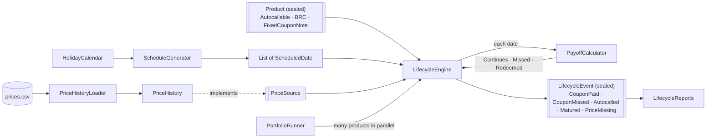

# Structured Product Lifecycle Engine

A Java library that replays market prices through structured products and produces their lifecycle as a list of events: coupons paid or missed, early redemptions (autocalls) and maturities.

Java 21 · Maven · JUnit 5 · Mockito · SLF4J. No frameworks.

## What it models

| Product | Coupon | Redemption |
|---|---|---|
| **Autocallable** | Paid only if the underlying is at or above the coupon barrier on the observation date; optional *memory* pays missed coupons later | Early, at full notional, if the price reaches the autocall trigger; otherwise at maturity |
| **Barrier Reverse Convertible** | Fixed, paid every period | At maturity: full notional above the capital barrier, otherwise notional × performance |
| **Fixed Coupon Note** | Fixed, paid every period | Full notional at maturity |

**Memory coupons:** if a coupon is missed and memory is on, it is owed. The next time a coupon is paid, the missed ones are paid with it. Memory owed at maturity below the coupon barrier is lost.

## Worked example

AAPL autocallable: notional 1,000,000 USD, initial price 200, coupon 8% a year paid quarterly (20,000), coupon barrier 70%, autocall trigger 100%, capital barrier 60%, memory on.

| Quarter | Price | % of initial | Events |
|---|---|---|---|
| Q1 | 180 | 90% | Coupon paid 20,000 |
| Q2 | 130 | 65% | Coupon missed 20,000 |
| Q3 | 125 | 62.5% | Coupon missed 20,000 |
| Q4 | 160 | 80% | Coupon paid **60,000** (this quarter + two missed) |
| Q5 | 205 | 102.5% | Coupon paid 20,000, **autocalled**: 1,000,000 returned, product ends |

Without memory, Q4 pays 20,000 and the two missed coupons are lost.

## Design decisions

- **Sealed types with exhaustive switches.** Products (`Autocallable`, `BarrierReverseConvertible`, `FixedCouponNote`), observation outcomes (`Continues`, `Missed`, `Redeemed`) and lifecycle events are sealed interfaces of records. Every `switch` over them has no `default`, so adding a new product or event is a compile error until every operation handles it.
- **One type per outcome, not flags or zeros.** A missed coupon is a `Missed` outcome carrying the unpaid amount, not a `Continues` with a zero coupon. A zero can't silently mean two things.
- **Events instead of a mutable status.** The engine returns a list of events. Whether a product is still alive, and its cash flows by month, are derived from those events (event sourcing), so products stay immutable.
- **State lives where it belongs.** Products are immutable contract terms; `PayoffCalculator` is a pure function of one product and one observation; the running memory-coupon total is a local variable in `LifecycleEngine.run`. Nothing mutable is shared, so `PortfolioRunner` runs products in parallel with `CompletableFuture` and no locks, and a test proves the parallel results equal the serial ones.
- **Dependencies behind interfaces.** The engine depends on `PriceSource`, not on the CSV-backed `PriceHistory`, so a production feed or a Mockito mock can be swapped in. `ScheduleGenerator` receives its `HolidayCalendar` and roll convention through its constructor.
- **Expected bad data is reported, not thrown.** `PriceHistoryLoader` collects malformed rows (bad dates, prices, duplicates, currency mismatches) as `LoadError`s with line numbers and loads the rest; only a missing file or wrong header fails the whole load. A missing price on an observation date becomes a `PriceMissing` event rather than an exception.
- **Money as a value type.** `Money` and `Percentage` wrap `BigDecimal` with a currency or scale, normalised in the constructor so `equals` and `hashCode` behave correctly.

## Architecture



| Package | Responsibility |
|---|---|
| `domain` | Value types: `Money`, `Percentage`, `Currency`, `Underlying`, `CommonTerms` |
| `schedule` | `HolidayCalendar`, roll conventions, `ScheduleGenerator` |
| `product` | The sealed `Product` hierarchy |
| `payoff` | `PayoffCalculator` and observation outcomes |
| `marketdata` | `PriceSource`, `PriceHistory`, CSV loader |
| `engine` | `LifecycleEngine` and lifecycle events |
| `reports` | Live products, timeline, cash flows by month (streams and collectors) |
| `runner` | `PortfolioRunner`: serial and parallel runs |

## Running the tests

```
mvn test
```

## Known limits

- The cash-flow report assumes a single currency; a multi-currency version would group by month and currency.
- The capital barrier is observed at maturity only (European); continuous knock-out barriers are not modelled.
- The last date in a schedule is treated as the final observation; if its price is missing, the product is reported unmatured rather than guessed.
- Products are built in code; there is no loader for product terms.
- No command-line entry point: this is a library exercised through its tests.